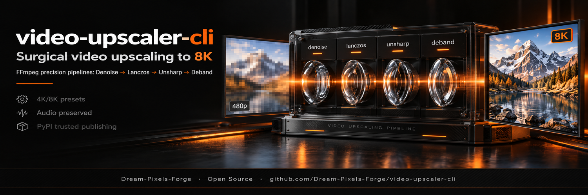

# video-upscaler-cli

High-precision video upscaling CLI and Python library built on FFmpeg filter pipelines. Transform low-resolution video into cinematic 4K/8K with surgical precision — denoise, lanczos scale, unsharp sharpen, deband — while preserving audio and delivering even-dimensioned output for H.264/H.265 compatibility.

## Architecture

The system is organized around a clean modular pipeline: probe → calculate → filter → encode.

### Pipeline Stages

**1. Probe** — Extracts media metadata using ffprobe: resolution, codec, pixel format, duration, FPS, audio codec, aspect ratio, and color space. Validates input existence and video stream presence.

**2. Calculate** — Resolution calculator determines target dimensions based on preset (720p, 1080p, 2K, 4K, 8K + DCI variants), fit strategy (fit/pad/crop), scale factor, or custom width/height. Enforces even-integer constraints for chroma subsampling and validates minimum 360p input resolution.

**3. Filter** — Precision filter chain assembles ffmpeg `-vf` graph: optional denoise (hqdn3d), lanczos scaling with accurate rounding and full chroma handling, unsharp edge restoration, and optional debanding. Each stage is parameterized by quality profile and denoise level.

**4. Encode** — FFmpeg execution engine runs the filter pipeline with configurable codec (libx264 default), x264 preset/CRF mapped from quality profile, pixel format yuv420p, and audio stream copy. Progress is reported by parsing ffmpeg stderr timecodes.

### Engines

- **FFmpegPrecisionEngine** — Single-invocation ffmpeg pipeline with progress tracking, filter chain injection, and error handling.
- **RealESRGANEngine** — Adapter for Real-ESRGAN binary (availability-checked, falls back gracefully).

### Configuration

`UpscaleConfig` holds preset, fit strategy, quality profile, denoise level, sharpen/deband toggles, codec, low-res allowance, scale factor, custom dimensions, and DCI flag.

---

## Features

- **Resolution presets:** 720p, 1080p, 2K (QHD/DCI), 4K (UHD/DCI), 8K (UHD/DCI), custom scale or dimensions
- **Fit strategies:** fit (aspect-preserving), pad (letterbox/pillarbox), crop (center-crop)
- **Quality profiles:** fast, medium, high, best — mapped to x264 preset and CRF
- **Filter pipeline:** denoise → lanczos scale → unsharp sharpen → deband
- **Audio preservation:** audio stream copied by default
- **Progress reporting:** real-time percent via ffmpeg stderr parsing
- **CLI and Python API:** both supported
- **PyPI distribution:** `pip install video-upscaler-cli`

---

## Installation

```bash
pip install video-upscaler-cli
```

---

## CLI Usage

```bash
# Upscale to 4K with high quality
video-upscale input.mp4 -p 4k --quality high --denoise gentle

# Upscale to 8K (use fast quality to fit memory)
video-upscale input.mp4 -p 8k --quality fast --denoise gentle

# Custom 2x scale
video-upscale input.mp4 --scale 2 -o output_2x.mp4

# DCI 4K (4096x2160)
video-upscale input.mp4 -p dci_4k --dci

# Pad to 1080p canvas
video-upscale input.mp4 -p 1080p --fit pad

# Allow inputs below 360p
video-upscale input.mp4 -p 720p --allow-low-res
```

### CLI Options

| Option | Description | Default |
|--------|-------------|---------|
| `-p, --preset` | Target resolution preset | `1080p` |
| `--fit` | Canvas fit strategy: fit/pad/crop | `fit` |
| `--quality` | Encoding quality: fast/medium/high/best | `medium` |
| `--denoise` | Denoise intensity: none/gentle/medium/strong | `gentle` |
| `--no-sharpen` | Disable unsharp sharpening | enabled |
| `--deband` | Enable debanding filter | disabled |
| `--scale N` | Scale factor (overrides preset) | — |
| `--width W / --height H` | Custom canvas dimensions | — |
| `--dci` | Use DCI variant for 2K/4K/8K | disabled |
| `--allow-low-res` | Allow inputs below 360p | disabled |
| `-o, --output` | Output path | `<stem>_<preset>.mp4` |

---

## Python API

```python
from video_upscaler import Upscaler, UpscaleConfig, Preset, FitStrategy, QualityProfile, DenoiseLevel

config = UpscaleConfig(
    preset=Preset.RES_4K,
    fit=FitStrategy.FIT,
    quality=QualityProfile.HIGH,
    denoise=DenoiseLevel.GENTLE,
    sharpen=True,
    deband=False,
)

upscaler = Upscaler(config)
result = upscaler.upscale("input.mp4", "output_4k.mp4")

print(result.output_path)   # Path to output file
print(result.resolution)    # (width, height) tuple
print(result.duration)      # Duration in seconds
```

---

## Presets Reference

| Preset | Resolution | DCI Variant (`--dci`) |
|--------|-----------|----------------------|
| 720p | 1280×720 | — |
| 1080p | 1920×1080 | — |
| 2K | 2560×1440 | 2048×1080 |
| 4K | 3840×2160 | 4096×2160 |
| 8K | 7680×4320 | 8192×4320 |

---

## License

MIT
